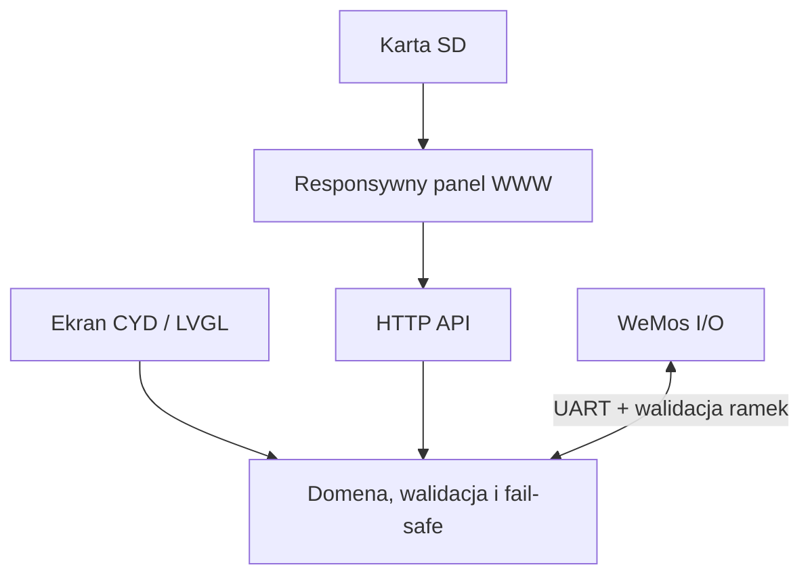

# Architektura repozytorium AquaCYD

## Reguła zależności

Logika bezpieczeństwa i stan fizyczny należą do firmware CYD. LVGL, HTTP i UART
są adapterami wokół domeny. Adapter może zlecić operację, lecz nie może
bezpośrednio wymusić GPIO ani pominąć walidacji.

Projekt nie posiada klientów natywnych ani transportów radiowych innych niż
Wi-Fi używane przez panel WWW.

## Granice modułów

- `firmware/cyd_controller` — wykonanie czasu rzeczywistego, bezpieczeństwo,
  interfejs lokalny i serwer WWW;
- `firmware/wemos_controller` — deterministyczne wejścia/wyjścia i UART;
- `firmware/shared/uart_protocol` — wspólny, ograniczony kontrakt przewodowy;
- `web` — źródło panelu, bez duplikowania reguł bezpieczeństwa;
- `sdcard` — wyłącznie artefakt generowany z `web`;
- `services/remote_gateway` — opcjonalne powiadomienia, odseparowane od pętli
  sterowania.

## Współbieżność

UI, I/O i nadzór mają własne zadania oraz heartbeat. Długie odpowiedzi HTTP są
strumieniowane bez ręcznego przejmowania gniazda. UART nie czeka na renderowanie
LVGL, zapis SD ani klienta WWW. Wspólny stan jest kopiowany pod krótką blokadą,
a kosztowne formatowanie odbywa się po jej zwolnieniu.

## Wersjonowanie i testy

Kontrakt UART i format OTA mają niezależne wersje. Nieznane pola są ignorowane,
a nieznane akcje odrzucane. Testy hostowe sprawdzają domenę i LVGL, testy API
sprawdzają WWW, a HIL sprawdza prawdziwy CYD i WeMos.
