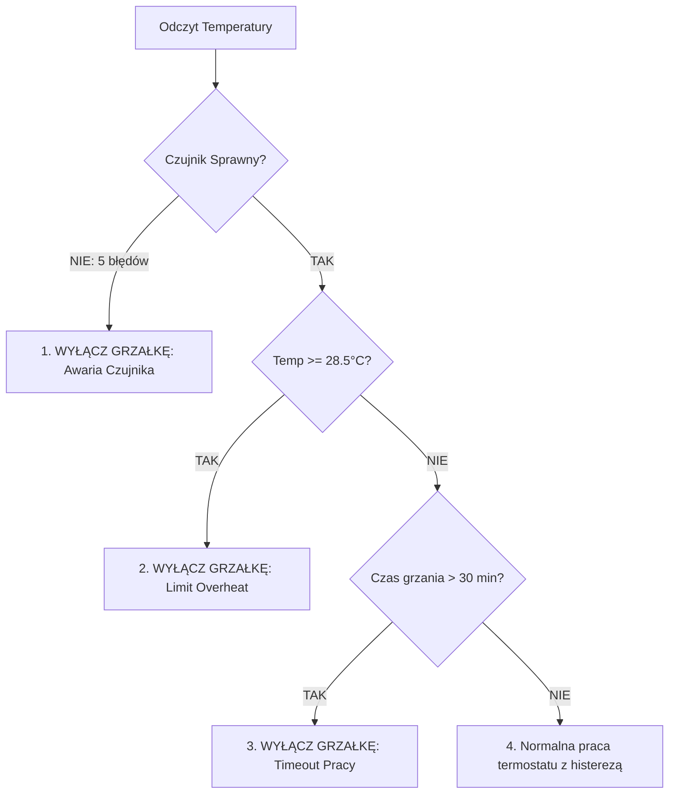

---
aliases:
  - Zabezpieczenia Grzałki
  - Heater Safety
tags:
  - safety
  - thermostat
category: safety
status: complete
---

# 🛡️ Bezpieczeństwo — Wielopoziomowe Zabezpieczenia Grzałki

Grzałka akwariowa o mocy 100-300W pracująca bez nadzoru może w ciągu kilkunastu godzin doprowadzić do śmiertelnego przegrzania obsady akwarium. Moduł [[Firmware - WeMos Termostat i TempControl|temp_control.cpp]] chroni zbiornik na 4 niezależnych poziomach.

Powrót do: [[MOC - Bezpieczeństwo i Fail-Safe]] | Algorytm: [[Firmware - WeMos Termostat i TempControl]]

---

## 📋 4 Poziomy Zabezpieczenia Grzałki

### 1. Awaria Czujnika Temperatury (Sensor Failure):
- Jeśli przewód termometru zostanie przerwany, czujnik wypadnie z wody lub magistrala 1-Wire ulegnie zakłóceniom:
- Kod zlicza błędy odczytu (`consecutive_read_errors_ >= 5`).
- Grzałka zostaje **bezwzględnie wyłączona**. Sterownik nigdy nie grzeje "w ciemno"!

### 2. Sprzętowy Limit Przegrzania (Overheat Limit):
- Zdefiniowany w `WemosConfig::TEMP_OVERHEAT_LIMIT = 28.5f`.
- Niezależnie od temperatury zadanej przez użytkownika, przekroczenie 28.5°C natychmiast odcina przekaźnik grzałki i zgłasza alarm `ALARM_OVERHEAT`.

### 3. Zabezpieczenie Czasowe (Heater Run Timeout):
- Zdefiniowane w `WemosConfig::HEATER_MAX_RUN_MS = 30 * 60 * 1000` (30 minut).
- Sprawnie dobrana grzałka podnosi temperaturę o histerezę 0.3°C w ciągu 10-15 minut.
- Ciągłe grzanie przez ponad 30 minut wskazuje na awarię (np. rozszczelnienie grzałki, otwarcie okna w pokoju lub uszkodzenie styków). Grzałka jest wyłączana, a do CYD trafia kod `ALARM_HEATER_TIMEOUT`.

### 4. Ostrzeżenie przed Przechłodzeniem (Underheat Alert):
- Spadek temperatury poniżej `21.0°C` generuje powiadomienie `ALARM_UNDERHEAT` (np. przypomnienie o wyłączonym bezpieczniku).

---

## 🔗 Powiązane Notatki
- [[Firmware - WeMos Termostat i TempControl]]
- [[Hardware - Termometr DS18B20 1-Wire]]
- [[Hardware - Moduł 8 Przekaźników]]
