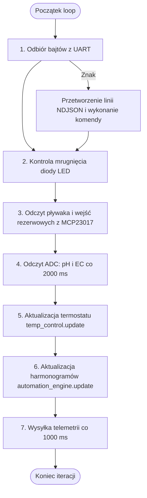

---
aliases:
  - WeMos main.cpp
  - Pętla Główna WeMos
tags:
  - firmware
  - esp8266
category: firmware
status: complete
---

# ⚙️ Firmware — Pętla Główna Sterownika (`main.cpp`)

Plik źródłowy: `firmware/wemos_controller/src/main.cpp`.
Odpowiada za inicjalizację podsystemów, nieblokujący odbiór komend z UART, egzekucję termostatu, harmonogramów oraz cykliczne wysyłanie telemetrii.

Powrót do: [[MOC - Firmware ESP8266 WeMos]] | Protokół: [[Protokół - Specyfikacja NDJSON UART]]

---

## ⏱️ Cykl Pracy Pętli `loop()`

Pętla główna wykonuje się setki razy na sekundę bez użycia blokujących funkcji `delay()`. Każde zadanie wywoływane jest na podstawie znacznika czasu `millis()`:



---

## 🔍 Kluczowe Fragmenty Kodu

### 1. Bezpieczna Inicjalizacja (`setup`):
```cpp
// Całkowite wyłączenie Wi-Fi
WiFi.mode(WIFI_OFF);
WiFi.forceSleepBegin();

// Inicjalizacja pamięci, I2C, czujnika temperatury i harmonogramów
g_storage_manager.begin();
g_storage_manager.loadConfig(current_config);
g_hardware_i2c.begin();
g_temp_control.begin();
g_automation_engine.begin();
```

### 2. Natychmiastowa Telemetria po Zmianie Stanu:
Gdy użytkownik przełączy przekaźnik lub zmieni temperaturę z poziomu CYD, funkcja `process_serial_line()` natychmiast wywołuje `send_telemetry()`. Dzięki temu interfejs na ekranie TFT i w przeglądarce aktualizuje się w czasie rzeczywistym bez czekania na kolejny interwał 1s.

---

## 🔗 Powiązane Notatki
- [[Firmware - WeMos Hardware I2C]]
- [[Firmware - WeMos Termostat i TempControl]]
- [[Firmware - WeMos AutomationEngine i Harmonogramy]]
- [[Firmware - WeMos Pamięć EEPROM i Storage]]
