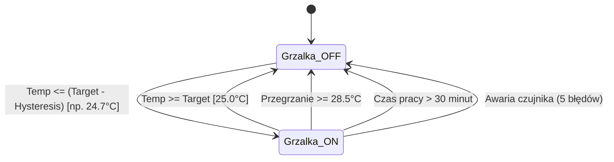

---
aliases:
  - WeMos temp_control
  - Termostat Akwarium
tags:
  - firmware
  - thermostat
  - safety
category: firmware
status: complete
---

# 🌡️ Firmware — Kontrola Temperatury i Termostat (`temp_control.cpp`)

Pliki: `firmware/wemos_controller/src/temp_control.h` oraz `.cpp`.
Klasa `TempControl` realizuje autonomiczny termostat akwariowy z histerezą oraz zbiorem zabezpieczeń awaryjnych (fail-safe).

Powrót do: [[MOC - Firmware ESP8266 WeMos]] | Zabezpieczenia: [[Bezpieczeństwo - Zabezpieczenia Grzałki]]

---

## ⚙️ Logika Termostatu z Histerezą

Domyślne parametry:
- Temperatura zadana: **25.0°C**
- Histereza: **0.3°C**

---

## 🛡️ Bezpieczeństwo i Alarmy
1. **Limit Ciągłego Czasu Pracy (30 minut)**:
   Stała `HEATER_MAX_RUN_MS = 30 * 60 * 1000`. Chroni przed ugotowaniem ryb w przypadku mechanicznego zablokowania styków przekaźnika lub rozszczelnienia grzałki.
2. **Filtr Awarii Czujnika**:
   Pojedynczy zakłócony odczyt nie wyłącza grzałki. Dopiero 5 kolejnych błędnych odczytów z DS18B20 (`consecutive_read_errors_ >= 5`) aktywuje flagę `ALARM_TEMP_SENSOR_FAIL` i odcina grzanie.
3. **Flagi Alarmowe**: Zwracane jako bitmaska w telemetrii do CYD.

---

## 🔗 Powiązane Notatki
- [[Bezpieczeństwo - Zabezpieczenia Grzałki]]
- [[Hardware - Termometr DS18B20 1-Wire]]
- [[Hardware - Moduł 8 Przekaźników]]
