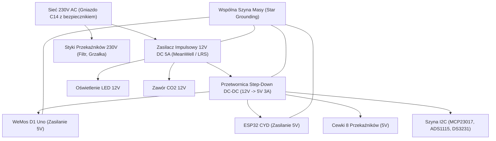

---
aliases:
  - Zasilanie AquaBox
  - Przetwornica 5V
  - Power Supply
tags:
  - hardware
  - power
category: hardware
status: complete
---

# ⚡ Hardware — Zasilanie Główne i Przetwornica Step-Down 5V

Bezpieczna i stabilna dystrybucja zasilania w obudowie [[AquaBox - Założenia Konstrukcyjne CAD|AquaBox]] jest fundamentem bezawaryjnej pracy 24/7.

Powrót do: [[MOC - Sprzęt i Peryferia]] | CAD: [[AquaBox - Założenia Konstrukcyjne CAD]]

---

## 🔌 Schemat Dystrybucji Zasilania

---

## ⚠️ Zasady Bezpieczeństwa Elektrycznego
1. **Separacja Galwaniczna i Odstępy Izolacyjne**: Przewody 230V AC są odseparowane fizycznie od linii sygnałowych 3.3V/5V.
2. **Punkt Masy Gwiaździstej (Star Ground)**: Masa zasilacza 12V i przetwornicy 5V spotykają się w jednym punkcie, co eliminuje pętle masy powodujące zakłócenia pomiarów sondy pH.
3. **Kondensatory Odsprzęgające**: Przy zasilaniu płytki przekaźników i przetwornicy zastosowano kondensatory elektrolityczne 470µF + ceramiczne 100nF tłumiące szpilki napięciowe przy wyłączaniu cewek.

---

## 🔗 Powiązane Notatki
- [[Hardware - Moduł 8 Przekaźników]]
- [[AquaBox - Założenia Konstrukcyjne CAD]]
- [[Hardware - WeMos D1 Uno ESP8266]]
