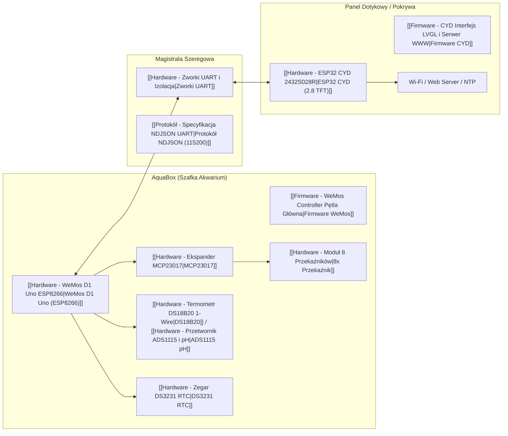

---
aliases:
  - Architektura Systemu
  - System Architecture
tags:
  - moc
  - architecture
category: moc
status: complete
---

# 🏛️ MOC — Architektura Systemu AquaCYD & AquaBox

System sterowania akwarium został zaprojektowany w **architekturze rozproszonej (dwuprocesorowej)**, która rozdziela zadania krytyczne czasowo i wykonawcze od obsługi bogatego interfejsu graficznego i sieci Wi-Fi.

Powrót do: [[00 - AquaCYD Knowledge Hub]]

---

## 🧩 Podział Odpowiedzialności

### 1. Sterownik Wykonawczy: [[Hardware - WeMos D1 Uno ESP8266]]
- **Lokalizacja**: Wewnątrz obudowy [[AquaBox - Założenia Konstrukcyjne CAD|AquaBox]].
- **Charakterystyka**: 100% autonomiczny, niezawodny, nieprzerwany cykl pracy 24/7.
- **Wi-Fi**: Wyłączone sprzętowo (`WiFi.mode(WIFI_OFF)`) — zero zakłóceń elektromagnetycznych, zero opóźnień na obsługę stosu sieciowego.
- **Odpowiedzialność**:
  - Pętla termostatu z histerezą ([[Firmware - WeMos Termostat i TempControl]]).
  - Harmonogramy czasowe oświetlenia, filtra, CO2 i napowietrzania ([[Firmware - WeMos AutomationEngine i Harmonogramy]]).
  - Odczyt sprzętowego zegara czasu rzeczywistego ([[Hardware - Zegar DS3231 RTC]]).
  - Bezpośrednia kontrola przekaźników i czujnika niskiego poziomu wody ([[Hardware - Ekspander MCP23017]]).
  - Pamięć konfiguracji w EEPROM z sumą CRC32 ([[Firmware - WeMos Pamięć EEPROM i Storage]]).

### 2. Panel Dotykowy i Bramka: [[Hardware - ESP32 CYD 2432S028R]]
- **Lokalizacja**: Na zewnątrz, panel operatorski lub na pokrywie.
- **Odpowiedzialność**:
  - Kolorowy interfejs graficzny LVGL 8.4 na ekranie 320x240 ze sterowaniem dotykowym.
  - Serwer HTTP i Dashboard WWW (dostęp z telefonu i komputera w sieci domowej).
  - Klient NTP — automatyczna synchronizacja czasu przez Internet i przesyłanie go do WeMos.
  - Generowanie dźwiękowych sygnałów alarmowych (buzzer GPIO26) w przypadku błędu z WeMos.
  - Integracja przez [[Firmware - CYD UartClient i Telemetria]].

### 3. Magistrala Łącząca i Zasilanie: Wiązka 4-przewodowa
- Połączenie WeMos $\leftrightarrow$ CYD zrealizowane jest pojedynczym kablem 4-żyłowym:
  1. **GND** — wspólna masa odniesienia i zasilania.
  2. **TX $\rightarrow$ RX** — linia telemetrii (WeMos TX `GPIO1` $\rightarrow$ CYD RX `GPIO3` przez zworkę `J_TX`).
  3. **RX $\leftarrow$ TX** — linia komend (WeMos RX `GPIO3` $\leftarrow$ CYD TX `GPIO1` przez zworkę `J_RX`).
  4. **5V** — linia zasilania panelu CYD ze stacji AquaBox (brak potrzeby osobnego zasilacza!).
- Format danych: czytelny **NDJSON** (New-line Delimited JSON) z prędkością 115200 baud.
- WeMos wysyła co 1 s [[Protokół - Struktura Telemetrii|ramkę telemetrii]], a CYD przesyła [[Protokół - Katalog Komend i Sterowanie|ramki komend]].
- Zabezpieczenie fizyczne do flashowania USB: [[Hardware - Zworki UART i Izolacja]].

---

## 🔗 Powiązane Notatki
- [[MOC - Sprzęt i Peryferia]]
- [[MOC - Protokół Komunikacji NDJSON]]
- [[MOC - Bezpieczeństwo i Fail-Safe]]
- [[Repo - Przegląd Projektów i Wersji]]
