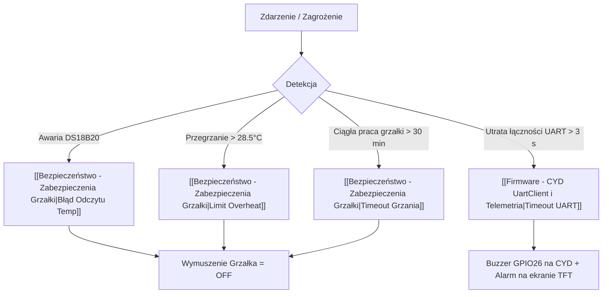

---
aliases:
  - Bezpieczeństwo i Fail-Safe
  - Safety MOC
tags:
  - moc
  - safety
category: moc
status: complete
---

# 🛡️ MOC — Bezpieczeństwo i Procedury Awaryjne (Fail-Safe)

W akwarystyce błąd sterownika może doprowadzić do ugotowania obsady, zalania mieszkania lub zatrucia ryb dwutlenkiem węgla. Projekt AquaCYD wdraża **wielowarstwową architekturę bezpieczeństwa**.

Powrót do: [[00 - AquaCYD Knowledge Hub]] | Kod termostatu: [[Firmware - WeMos Termostat i TempControl]]

---

## 🚨 Warstwy Ochronne i Interlocki

---

## 📋 Główne Mechanizmy Zabezpieczeń

| Zagrożenie | Wykrycie | Reakcja Sterownika WeMos | Sygnalizacja na CYD / WWW | Notatka |
| :--- | :--- | :--- | :--- | :--- |
| **Przegrzanie wody (>28.5°C)** | DS18B20 odczytuje T >= 28.5°C | Wyłączenie przekaźnika grzałki, flaga `ALARM_OVERHEAT` | Ikona płomienia, powiadomienie dźwiękowe | [[Bezpieczeństwo - Zabezpieczenia Grzałki]] |
| **Uszkodzenie sondy temp.** | 5 kolejnych błędnych odczytów (np. -127°C lub 85°C) | Wymuszenie `heater_active = false`, flaga `ALARM_TEMP_SENSOR_FAIL` | Ostrzeżenie o braku czujnika | [[Bezpieczeństwo - Zabezpieczenia Grzałki]] |
| **Sklejony styk termostatu** | Praca grzałki nieprzerwanie przez > 30 minut | Odcięcie przekaźnika, flaga `ALARM_HEATER_TIMEOUT` | Alarm przekroczenia limitu czasu | [[Bezpieczeństwo - Zabezpieczenia Grzałki]] |
| **Niski poziom wody** | Pływak MIN w komorze pompy (zwarcie na GPB2) | Flaga `ALARM_WATER_LOW`, zablokowanie dolewki | Komunikat o konieczności uzupełnienia wody | [[Hardware - Czujnik Poziomu Wody]] |
| **Brak zasilania sieciowego** | Reset mikrokontrolera | Odczyt czasu z bateryjnego DS3231 RTC, odtworzenie harmonogramu bez Wi-Fi | Automatyczny powrót do właściwego stanu | [[Hardware - Zegar DS3231 RTC]] |

---

## 🔗 Powiązane Notatki
- [[Bezpieczeństwo - Zabezpieczenia Grzałki]]
- [[Hardware - Czujnik Poziomu Wody]]
- [[Firmware - WeMos Termostat i TempControl]]
