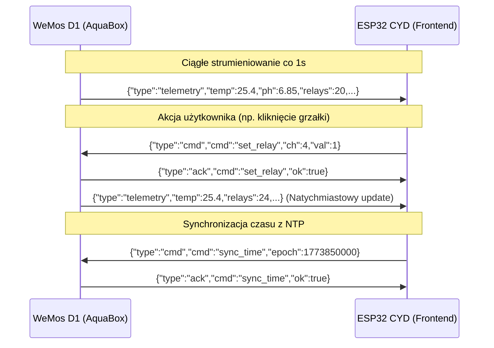

---
aliases:
  - Protokół Komunikacji
  - UART NDJSON MOC
tags:
  - moc
  - protocol
  - uart
category: moc
status: complete
---

# 📡 MOC — Protokół Komunikacji UART NDJSON

Magistrala komunikacyjna pomiędzy **ESP32 CYD** a **WeMos D1 Uno (ESP8266)** wykorzystuje format **NDJSON (New-line Delimited JSON)** przesyłany z prędkością **115200 baud**.

Powrót do: [[00 - AquaCYD Knowledge Hub]] | Kod źródłowy: `firmware/shared/uart_protocol/`

---

## 💡 Główne Założenia Protokołu

1. **Format Czystego Tekstu**: Każda ramka jest poprawnym obiektem JSON zakończonym znakiem nowej linii `
`. Pozwala to na łatwy podgląd i debugowanie na żywo w monitorze portu szeregowego.
2. **Dwukierunkowość**:
   - **WeMos -> CYD**: Cykliczna [[Protokół - Struktura Telemetrii|ramka telemetrii]] co 1000 ms oraz natychmiast po wykonaniu komendy.
   - **CYD -> WeMos**: [[Protokół - Katalog Komend i Sterowanie|Ramki komend operatorskich]] (przełączanie przekaźników, zmiana temp, synchronizacja NTP, karmienie).
   - **WeMos -> CYD**: [[Protokół - Potwierdzenia ACK i Błędy|Ramki potwierdzenia ACK]] po przetworzeniu komendy.
3. **Mechanizm Failsafe**: Jeśli CYD nie odbierze telemetrii przez ponad **3000 ms**, sygnalizuje błąd połączenia na ekranie oraz uruchamia sygnał ostrzegawczy na buzzerze.

---

## 📄 Podsumowanie Ramek

---

## 🔗 Powiązane Notatki
- [[Protokół - Specyfikacja NDJSON UART]]
- [[Protokół - Struktura Telemetrii]]
- [[Protokół - Katalog Komend i Sterowanie]]
- [[Protokół - Potwierdzenia ACK i Błędy]]
- [[Hardware - Zworki UART i Izolacja]]
