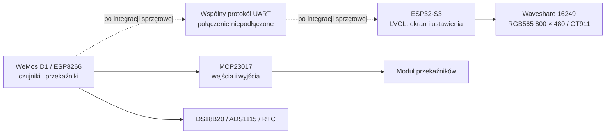

---
aliases:
  - Architektura Systemu
  - AquaBox architecture
tags:
  - moc
  - architecture
category: moc
status: active
---

# MOC — architektura AquaBox

Aktywne repozytorium utrzymuje dwa oddzielne firmware: sterownik wejść/wyjść
WeMos D1 Uno oraz panel LVGL ESP32-S3. Wspólny UART jest zaplanowany w kodzie,
ale fizyczne połączenie i przepływ telemetrii nie są jeszcze potwierdzone.

Powrót: [[00 - AquaCYD Knowledge Hub]]

## 1. Sterownik wykonawczy — WeMos D1

Firmware znajduje się w `firmware/wemos_controller/`. Piny i urządzenia
peryferyjne opisano w `firmware/wemos_controller/include/wemos_config.h`.
WeMos obsługuje czujniki, zegar RTC i przekaźniki. Testy konkretnych linii są
oddzielnymi środowiskami `test_wemos_*`.

Szczegóły: [[MOC - Firmware ESP8266 WeMos]] oraz [[MOC - Sprzęt i Peryferia]].

## 2. Panel HMI — ESP32-S3

Firmware znajduje się w `firmware/esp32s3_ui/`; ekran jest podłączony przez
RGB równoległe, a GT911 przez I²C. Panel zawiera pięć kart głównych, ustawienia
harmonogramu i historię, motywy jasny/ciemny oraz diagnostykę.

S3 obecnie korzysta z lokalnego modelu. Brak UART oznacza, że UI nie pokazuje
potwierdzonej telemetrii sterownika WeMos.

Szczegóły: [[Firmware - ESP32-S3 Panel UI]] i
[[Hardware - ESP32-S3 Waveshare 16249]].

## 3. Interfejs między urządzeniami

Kod wspólnego formatu jest w `firmware/shared/uart_protocol/`. Do czasu
podłączenia przewodów i przetestowania ramek nie należy przedstawiać go jako
działającego łącza. Po integracji wymagane będą testy poprawności ramek,
utraty łącza, timeoutów i bezpiecznego stanu wyjść.

Szczegóły: [[MOC - Protokół Komunikacji NDJSON]] oraz
[[Hardware - Zworki UART i Izolacja]].

## 4. Obudowa i bezpieczeństwo

STL podstawy i pokrywy są w `3d-print/AquaBox-Case/`; źródła SolidWorks
pozostają w archiwum. Dopasowanie mechaniczne do aktualnego wyposażenia nie
zostało ponownie zmierzone. Obwody sieciowe wymagają odrębnej oceny izolacji,
odstępów i ochrony przed wodą.

[[MOC - Bezpieczeństwo i Fail-Safe]] · [[MOC - Obudowa AquaBox i CAD]]
